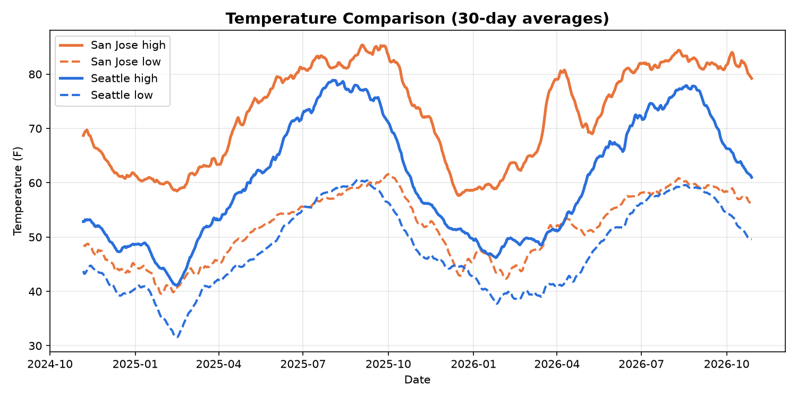
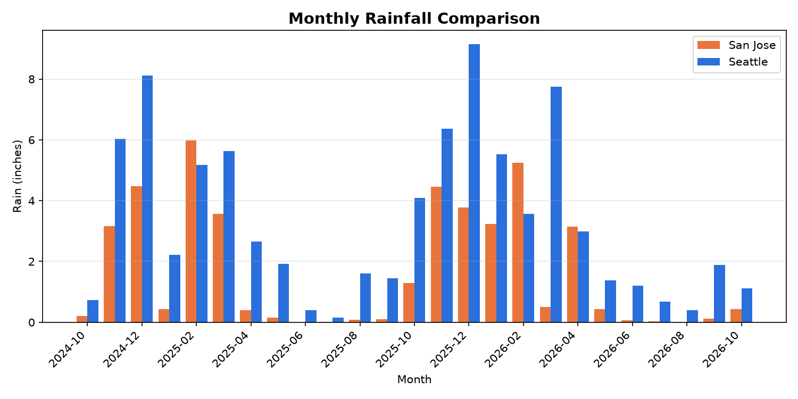

# Weather Data Project

Collects two years of daily weather for San Jose from the free Open-Meteo
Historical Weather API, saves it to CSV, and charts temperature and rainfall trends.

## What it does
- Pulls daily high/low temperature, rainfall, and wind speed from a public REST API
- Saves the data to `weather_data.csv`
- Prints highlights and builds monthly summaries
- Charts daily temperatures (with a 30-day average) and monthly rainfall

## Results (Oct 2024 - Oct 2026)
- Hottest day: 100.8 F (Sep 9, 2026); coldest night: 29.8 F (Feb 10, 2025)
- 145 rainy days (19.8% of days), 41.4 inches of rain in total
- Rain falls almost entirely between October and April; summers are nearly dry

## How to run
    pip install -r requirements.txt
    python weather_project.py

## Tools
Python, requests, pandas, matplotlib. Data: https://open-meteo.com